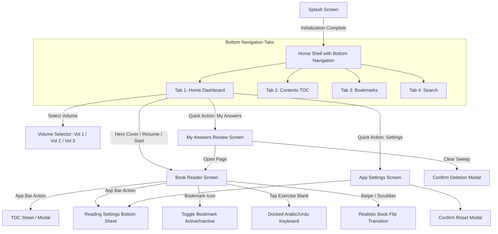

# Fehm-e-Quran (فہم القرآن) — Comprehensive UX/UI Design Specification
### Full Design Document for Figma Designers & Design Systems Engineering
**Version:** 2.0 (Production Design Guide)  
**Target Platform:** Mobile (iOS & Android — Primary: 390×844pt / Scale to Tablet 834×1194pt)  
**Primary Language Modes:** Bilingual UI (Urdu & English) with Arabic Quranic Content (Bi-directional LTR/RTL support)

---

## 1. Executive Summary & Design Vision

### 1.1 Product Purpose
**Fehm-e-Quran (مُعَلِّمُ الْقُرْآن — Muallim-ul-Quran)** is an interactive, digital Quranic Arabic learning application based on the celebrated classical curriculum by Maulana Ubaid-ur-Rahman Nadvi. The app transforms a 3-volume printed book course into an elegant, tactile, and interactive digital study companion.

Learners read the original curriculum pages, study grammatical rules, memorize vocabulary, and interactively complete exercises by typing answers with a specialized custom on-screen Arabic/Urdu keyboard featuring full diacritics (Harakat/Tashkeel).

### 1.2 Aesthetic & Emotional Pillars
1. **Sacred Heritage & Tactile Classical Feel:** A refined, dignified book aesthetic evoking authentic Islamic scholarship—warm manuscript paper textures, subtle spine shadows, delicate calligraphic framing, and classical typography.
2. **Modern Cognitive Clarity:** Free from visual noise. High-legibility typography, balanced white space, and clear spatial separation between Quranic text, Urdu explanations, and interactive exercises.
3. **Seamless Pedagogical Interactivity:** Exercises, word pairs, and vocabulary lists are not static text; they are alive with inline inputs, live grading feedback, self-testing "Practice Mode", and instant diacritic checking.

---

## 2. Design System Foundations

### 2.1 Color Tokens & Themes

The app features **3 distinct reading environments** plus global brand tokens. The designer must design every screen and block with these color sets.

#### Global Brand Colors
| Token Name | HEX | RGB | Purpose / Usage |
| :--- | :--- | :--- | :--- |
| `brand-burgundy-dark` | `#3E0F0C` | `62, 15, 12` | Splash background, brand accents, primary buttons |
| `brand-burgundy` | `#7A1F1A` | `122, 31, 26` | Active volume card, primary brand headers, badge tint |
| `brand-gold-primary` | `#E6C77A` | `230, 199, 122` | Calligraphy stroke, active gold borders, luxury accents |
| `brand-gold-muted` | `#D08A1E` | `208, 138, 30` | Interactive focus rings, cursor caret, slider active track |

#### Theme 1: Paper (Default / Classical Cream)
*Emulates high-quality cream Quranic book paper.*
- **Paper Canvas (`paper`):** `#FBF6EA`
- **Paper Shade (`paperShade`):** `#EDE3CC` (Gutter gradient & card containers)
- **Ink Primary (`ink`):** `#2B2118` (Primary text & reading typography)
- **Ink Muted (`muted`):** `#7A6D5E` (Subtitles, metadata, secondary instructions)
- **Accent Red (`red`):** `#C0392B` (Newly introduced vocabulary, bookmarks, errors)
- **Accent Border (`border`):** `#8C6D46` (Frames, dividers, borders)
- **Verse Highlight (`verseTint`):** `#F3EAD3` (Quran verse block container)
- **Box Tint (`boxTint`):** `#FFF4E0` (Grammar rules & summary container)
- **Correct State (`correct`):** `#2E7D32` (Graded right checkmark & underline)
- **Incorrect State (`incorrect`):** `#C62828` (Graded wrong cross & correction)
- **Input Line (`fieldLine`):** `#AA9A80` (Inactive blank underline)

#### Theme 2: Sepia (Warm Evening Manuscript)
*Warm vintage parchment for reduced eye strain.*
- **Paper Canvas:** `#F1E3C6`
- **Paper Shade:** `#DCC8A2`
- **Ink Primary:** `#3B2A17`
- **Ink Muted:** `#7D6446`
- **Accent Red:** `#A93226`
- **Accent Border:** `#7A5A33`
- **Verse Highlight:** `#E8D6B1`
- **Box Tint:** `#F6E6C4`
- **Correct State:** `#2E6B2F`
- **Incorrect State:** `#B0281F`
- **Input Line:** `#9C8460`

#### Theme 3: Night / Dark (Comfort Reading)
*OLED-friendly dark slate with warm luminescence.*
- **Paper Canvas:** `#1E1B17`
- **Paper Shade:** `#12100D`
- **Ink Primary:** `#E9E1D0`
- **Ink Muted:** `#A3978A`
- **Accent Red:** `#EF7A6A`
- **Accent Border:** `#A88A60`
- **Verse Highlight:** `#2A251F`
- **Box Tint:** `#2E2619`
- **Correct State:** `#81C784`
- **Incorrect State:** `#EF8A80`
- **Input Line:** `#6E6254`

---

### 2.2 Typography Hierarchy & Fonts

Three dedicated font families are used:
1. **Arabic Content:** `Amiri` (Classical Naskh with comprehensive Tashkeel/Harakat glyph support).
2. **Urdu Content:** `Noto Nastaliq Urdu` (Authentic Nastaliq ligature flow for Urdu descriptions, translations, and notes).
3. **App System UI:** Platform system font (`SF Pro` on iOS, `Roboto` on Android) or `Inter` for English interface elements; `Noto Nastaliq Urdu` for Urdu UI.
4. **Math & Symbols:** `BookSymbols` / `Noto Sans Math` (for arrows like `←`, `↔`, brackets, and tabular guides).

#### Typography Scale Specs
| Style Role | Font Family | Size | Weight | Line Height | Script / Usage |
| :--- | :--- | :--- | :--- | :--- | :--- |
| **Hero Title (Splash/Cover)** | Amiri | `44pt` | Bold | `1.6` | "مُعَلِّمُ الْقُرْآن" |
| **Unit Title / Cover Header** | Amiri | `28pt` | Bold | `1.5` | Unit Cover Arabic titles |
| **Quranic Verse Primary** | Amiri | `22pt–26pt` | Regular | `2.0` | Quranic Arabic verses with full Harakat |
| **Vocab Arabic Word** | Amiri | `20pt` | SemiBold | `1.6` | Vocabulary tables & cards |
| **Section Heading (Urdu)** | Noto Nastaliq Urdu | `18pt` | Bold | `2.2` | Lesson titles & grammar headers |
| **Urdu Translation / Explanations**| Noto Nastaliq Urdu | `15pt` | Regular | `2.0` | Lesson paragraphs, meanings, notes |
| **Exercise Prompt / Instruction** | Noto Nastaliq Urdu | `14pt` | Medium | `1.9` | Question instructions, blanks |
| **Answer Input Text (Arabic)** | Amiri | `20pt` | Regular | `1.6` | Active learner input in blanks |
| **Answer Input Text (Urdu)** | Noto Nastaliq Urdu | `15pt` | Regular | `1.9` | Active learner translation input |
| **Navigation & App Bar Title** | System / SF Pro | `17pt` | SemiBold | `1.2` | Top Bar titles |
| **Tab Bar Labels** | System / SF Pro | `11pt` | Medium | `1.2` | Bottom nav destinations |
| **Page Number Badges & Metadata** | Amiri / System | `12pt–13pt`| Medium | `1.2` | Page fractions, badges, dates |

---

### 2.3 Spatial Grid, Radius & Layout Rules
- **Base Grid Unit:** `4pt` / `8pt` rhythm.
- **Screen Margins:** `16pt` horizontal on mobile phones; `24pt`–`32pt` on tablets.
- **Card Padding:** `12pt` to `16pt`.
- **Corner Radii Tokens:**
  - `radius-sm`: `6pt` (badges, chips, tags)
  - `radius-md`: `10pt`–`12pt` (buttons, volume shelf tiles, answer inputs)
  - `radius-lg`: `16pt` (action tiles, book cover card, bottom sheets)
  - `radius-book-page`: `10pt` right-side curved corner (replicating physical book cut).
- **Elevation & Shadows:**
  - `shadow-book-spine`: `Offset(-2, 2)`, blur `10`, opacity `0.18` (deep spine shadow on inner gutter).
  - `shadow-floating`: `Offset(0, 4)`, blur `16`, opacity `0.12` (bottom sheets and keyboards).

---

## 3. Information Architecture & Navigation Map

---

## 4. Screen-by-Screen Exhaustive Specifications

Every screen, tab, modal, sheet, and interactive state in the application is documented below.

---

### Screen 1: Splash & Initializing Screen
* **Screen ID:** `SCR_01_SPLASH`
* **Route:** `/`
* **Purpose:** Brand welcome, Firebase initialization, custom font license loading, and reading asset caching.

#### Layout Specifications
- **Background:** Deep rich burgundy brand background (`#3E0F0C`).
- **Centered Vertical Column:**
  1. **Book Title Calligraphy (Arabic):** `مُعَلِّمُ الْقُرْآن` in font `Amiri`, size `44pt`, color `#E6C77A` (Golden metallic warmth).
  2. **Subtitle (Urdu):** *قرآنی عربی سکھانے کا آسان اور مکمل کورس* (Font: `Noto Nastaliq Urdu`, `16pt`, color `#FFFFFFB3`).
  3. **Spacing:** `32pt` gap.
  4. **Activity State Indicator:**
     - **Loading State:** Refined circular progress indicator (`28×28pt`, stroke `2.5pt`, color `#E6C77A`).
     - **Error State:** Warning icon (`Icons.error_outline`, color `#EF7A6A`), error message string ("Couldn't load the book / کتاب لوڈ نہیں ہو سکی"), and a golden rounded button `[Try Again / دوبارہ کوشش کریں]`.
- **Transitions:** Seamless fade-out (`500ms` duration) transitioning directly into `HomeShell`.

---

### Screen 2: Home Shell & Bottom Navigation Bar
* **Screen ID:** `SCR_02_HOME_SHELL`
* **Purpose:** Persistent application frame containing the 4 primary tabs.

#### Component Breakdown & Navigation Bar Specs
- **Navigation Bar Style:** Modern Material 3 floating or docked pill bar with active pill indicators.
- **Height:** `64pt` + system bottom safe area.
- **Destinations (4 Tabs):**
  1. **Home (`Tab 0`):** Icon `Icons.home_outlined` / Active `Icons.home` — Label: "Home" / "ہوم"
  2. **Contents (`Tab 1`):** Icon `Icons.toc_outlined` / Active `Icons.toc` — Label: "Contents" / "فہرست"
  3. **Bookmarks (`Tab 2`):** Icon `Icons.bookmarks_outlined` / Active `Icons.bookmarks` — Label: "Bookmarks" / "نشانات"
  4. **Search (`Tab 3`):** Icon `Icons.search` / Active `Icons.search` — Label: "Search" / "تلاش"
- **App Bar Behavior:**
  - On **Home Tab**: App bar is hidden for an immersive hero experience.
  - On **Tabs 1, 2, 3**: Top App Bar displays section title with elevation `0` and matching background.
- **Exit Back-Press Toast:** Double-tap back protection shows bottom SnackBar: *"Press back again to exit / باہر نکلنے کے لیے دوبارہ دبائیں"*.

---

### Screen 3: Home Dashboard (Screen 3.0)
* **Screen ID:** `SCR_03_HOME_DASHBOARD`
* **Purpose:** Central hub for volume selection, continuing reading, quick progress overview, and core shortcuts.

#### Layout Structure (Top to Bottom Scrollable View)
1. **Volume Shelf (Multi-Volume Switcher):**
   - 3 interactive cards in a horizontal row:
     * **Volume 1 (جلد اول):** Covers Units 1–3 (`vol1`)
     * **Volume 2 (جلد دوم):** Covers Units 4–5 (`vol2`)
     * **Volume 3 (جلد سوم):** Covers Unit 6 (`vol3`)
   - **Active State:** Background `#7A1F1A`, Border `1.5pt` `#E6C77A`, Text `#FFFFFF`, Icon gold `menu_book`.
   - **Inactive State:** Background `surfaceContainerHighest` (`#EDE3CC` in light), Border transparent, text muted, icon `book_outlined`.
   - **Responsive Behavior:** If screen width < `380pt`, stack icon above text labels; otherwise inline row.

2. **Hero Book Cover Display:**
   - **Aspect Ratio:** Generous framed card (Elevation `4`, rounded `16pt`).
   - **Artwork / Border:** Double-line ornate traditional Islamic border with ornate corner brackets (`styled_frame`).
   - **Cover Typography:**
     - Large Arabic title: `مُعَلِّمُ الْقُرْآن` (`36pt`, Gold `#E6C77A`)
     - Volume Subtitle: `جلد اوّل` / `جلد دوم` / `جلد سوم` (`20pt`, Bold, White)
     - Tagline (Urdu): "قرآنی عربی سکھانے کا آسان اور مکمل کورس"
     - Author Attribution: "مولانا عبید الرحمن ندوی"
   - **Tap Interaction:** Tapping anywhere on the cover immediately opens the reader at the last-read page (or Page 1).

3. **"Continue Reading" Resume Card (Conditional):**
   - *Displayed whenever user has progress.*
   - **Card Structure:**
     - Left: Circular avatar with burgundy background and `Icons.auto_stories` white icon.
     - Center Column:
       * Primary Label: "Continue reading / مطالعہ جاری رکھیں" (`15pt`, Bold)
       * Location Subtitle: "Unit 1 · Lesson 3 (p. 24) / یونٹ ۱ · سبق ۳" (`13pt`, Muted)
       * Progress Bar: Rounded LinearProgressIndicator (`height: 5pt`, active track: burgundy `#C0392B`, background: paperShade).
     - Right: Page fraction counter e.g. `24/180`.

4. **2×2 Quick Action Grid:**
   - **Tile 1: Read From Start (`Icons.menu_book_outlined`):** Opens reader at index `0`.
   - **Tile 2: Table of Contents (`Icons.toc`):** Switches directly to Tab 1.
   - **Tile 3: My Answers (`Icons.edit_note`):** Opens `AnswersReviewScreen`. Contains real-time badge pill showing saved answer count (e.g. `34`).
   - **Tile 4: Settings (`Icons.tune`):** Opens `SettingsScreen`.

---

### Screen 4: Core Book Reader Screen
* **Screen ID:** `SCR_04_READER_MAIN`
* **Route:** `/reader`
* **Purpose:** The core learning environment. Digital simulation of the printed book page with full interactivity.

#### 4.1 Top App Bar
- **Back Arrow:** Returns to Home Shell.
- **Title:** Centered, scale-down page location e.g., *"Unit 1 · Lesson 2: Noun & Verb / یونٹ ۱ · سبق ۲"*.
- **Action 1 (Bookmark Toggle):** Bookmark icon (`Icons.bookmark_border` when unbookmarked; filled `Icons.bookmark` with burgundy tint when saved).
- **Action 2 (Table of Contents):** `Icons.toc` opens modal TOC.
- **Action 3 (Reading Settings):** `Icons.text_fields` opens bottom settings sheet.

#### 4.2 Book Page Canvas & Tactile Details
- **Page Container:** Soft rounded right-edge corner (`10pt`), simulating page edge.
- **Spine Shadow (Gutter):** Subtle vertical gradient along the spine (right side in RTL) with dark-to-transparent overlay simulating book binding depth.
- **Page Header:** Pinned badge with lesson marker e.g., `سبق نمبر ۱` inside a decorative oval cartouche, flanked by a delicate golden bookmark ribbon icon if active.
- **Page Body:** Scrollable vertical block column with `12pt` gap between content blocks.
- **Page Footer:** Centered printed page number in Arabic numerals (e.g., `ـ ۲۴ ـ`) and book copyright/volume indicator.

#### 4.3 Bottom Navigation & Page Scrubber
- Located at bottom of screen when keyboard is closed.
- **Height:** `52pt`.
- **Direction:** Always strict **Right-to-Left (RTL)** to mirror Arabic book pagination.
- **Controls:**
  1. Next Page Button (Left in RTL, pointing left to advance).
  2. Interactive Slider: Division count equal to total pages; floating thumb shows current page tooltip e.g. `صفحہ ۲۵`.
  3. Page Counter: e.g. `25 / 186`.
  4. Previous Page Button (Right in RTL, pointing back to earlier pages).

---

### Screen 5: In-App Arabic & Urdu Harakat Keyboard (Docked Component)
* **Component ID:** `CMP_05_ARABIC_KEYBOARD`
* **Position:** Docked to screen bottom upon tapping any exercise blank in the reader.
* **Elevation:** `8pt` with top border divider.

#### Structure & Keyboard Toolbar
1. **Top Control Bar (`40pt` height):**
   - **Language Toggle:** Compact SegmentedButton switching between **Arabic (عربی)** and **Urdu (اردو)** character sets.
   - **Spacer**
   - **Native Keyboard Toggle:** Icon `Icons.keyboard_alt_outlined` (switches to device native Gboard/iOS keyboard).
   - **Dismiss Button:** Icon `Icons.keyboard_hide_outlined` or checkmark to close.

2. **Dedicated Harakat (Tashkeel) Row:**
   - Dedicated top row of 10 diacritic buttons drawn on dotted circle bases (`◌`):
     1. **Fatha (Zabar):** `◌َ`
     2. **Kasra (Zer):** `◌ِ`
     3. **Damma (Pesh):** `◌ُ`
     4. **Fathatan (Do Zabar):** `◌ً`
     5. **Kasratan (Do Zer):** `◌ٍ`
     6. **Dammatan (Do Pesh):** `◌ٌ`
     7. **Shadda (Tashdeed):** `◌ّ`
     8. **Sukun (Jazm):** `◌ْ`
     9. **Superscript Alef (Khara Zabar):** `◌ٰ`
     10. **Tatweel (Elongation):** `ـ`

3. **Character Rows (Arabic / Urdu):**
   - 3 rows of full alphabet keys arranged in standard Arabic/Urdu keyboard layout.
   - Long-press or repeat support on Backspace.
   - Haptic feedback on every tap.

4. **Function Row:**
   - Numbers / Symbols toggle button (`١٢٣` / `اب`)
   - Arabic comma (`،`) and full stop (`۔` in Urdu, `.` in Arabic)
   - Large Space Bar with script label ("عربی" / "اردو")
   - Backspace icon button (`Icons.backspace_outlined`)
   - Primary Submit / Done Button (`Icons.check`, primary color)

---

### Screen 6: Interactive Exercise Blanks & Graded State Machine
* **Component ID:** `CMP_06_EXERCISE_BLOCKS`
* **Purpose:** Embedded in reader pages for fill-in-the-blanks, translation drills, and grammar analysis.

#### Visual States of an Answer Field (`AnswerField`)
1. **Empty / Default State:**
   - Underline border in neutral line color (`#AA9A80`).
   - Hint text: "Write in Arabic / عربی میں لکھیں" or "Write your answer / جواب لکھیں" in muted italic.
2. **Active / Focused State:**
   - Tinted background box (`accent` with `8%` opacity).
   - Underline color changes to glowing accent gold (`#D08A1E`, width `2pt`).
   - Docked Arabic keyboard slides up automatically; view scrolls so the blank remains visible.
3. **Filled (Ungraded) State:**
   - Learner's typed text rendered in large, clear font (`Amiri 20pt` for Arabic; `Noto Nastaliq Urdu 15pt` for Urdu).
   - Small Check Button icon (`[✓ Check]`) displayed beside or below the field.
4. **Graded Correct State:**
   - Underline turns vibrant green (`#2E7D32`, width `2pt`).
   - Right side trailing icon: Green filled checkmark circle (`Icons.check_circle`).
5. **Graded Incorrect State:**
   - Underline turns coral red (`#C62828`, width `2pt`).
   - Right side trailing icon: Red cancel circle (`Icons.cancel`).
   - Reveal Line below the field: "Correct answer: [Correct Arabic Text]" in green text.
6. **Narrow Column / Table Cell Variant:**
   - In tight table cells, the Check button stacks beneath the text field rather than side-by-side to prevent text clipping.

---

### Screen 7: Reading Settings Bottom Sheet
* **Screen ID:** `SCR_07_READING_SETTINGS_SHEET`
* **Trigger:** App Bar text icon on Reader Screen.
* **Format:** Modal Bottom Sheet with drag handle.

#### Controls & Options
1. **Theme Mode Segmented Button:**
   - 3 Options with icon & text:
     * **Paper (`Icons.light_mode_outlined`):** "Paper / سفید/کریم"
     * **Sepia (`Icons.coffee_outlined`):** "Sepia / زردی مائل"
     * **Night (`Icons.dark_mode_outlined`):** "Night / تاریک"
2. **Font Size Scaling Slider:**
   - Left icon `Icons.text_decrease`, Right icon `Icons.text_increase`.
   - Discrete 8-step slider from `80%` to `160%` with live percentage badge e.g. `100%`.
3. **Practice Mode Toggle (Switch):**
   - Title: "Practice mode / مشق کا موڈ"
   - Subtitle: "Hide the book's printed meanings and translations and test yourself / کتاب کے معانی چھپا کر خود کو آزمائیں"
4. **Strict Diacritics Checking Toggle (Switch):**
   - Title: "Strict checking / سخت جانچ"
   - Subtitle: "Harakat (zabar, zer, pesh) must also match / حرکات کا ہو بہو ملنا ضروری ہے"
5. **Footer Action:**
   - "All Settings / مزید ترتیبات" text button with arrow navigating to full `SettingsScreen`.

---

### Screen 8: Table of Contents Screen / Tab
* **Screen ID:** `SCR_08_TOC`
* **Formats:** Available as persistent **Bottom Tab 2** or as a **Modal Page Selector** from inside the reader.

#### Layout Specifications
1. **Horizontal Quick Filter Chip Bar:**
   - Horizontally scrollable pill chips:
     * `[ Introduction / مقدمہ ]`
     * `[ Unit 1 / یونٹ ۱ ]`
     * `[ Unit 2 / یونٹ ۲ ]`
     * `[ Unit 3 / یونٹ ۳ ]`
     * `[ Exam & Appendix / ماڈل پیپر ]`
     * `[ Book's Contents / کتاب کی اپنی فہرست ]`
   - Tapping any chip smoothly scrolls the list directly to that header section.
2. **Hierarchical Content Tree:**
   - **Front Matter Section:** Title e.g., "عرض ناشر", "مقدمہ", "طریقہ تدریس" with printed page badges.
   - **Unit Headers:** Prominent banner with unit number badge, unit title, and page count.
   - **Lesson Cards:**
     * Lesson Number & Title (e.g. "سبق ۱: کلمہ اور اس کی قسمیں")
     * Lesson page range (e.g. "صفحہ ۱۰ تا ۱۴ · ۵ صفحات")
     * Active lesson indicator dot if current reader position is inside this lesson.
   - **Printed Original Table of Contents:** Direct digital reproduction of the original book's tabular contents with topic, lesson number, and original printed page numbers.
   - **Footer:** Total pages counter e.g. "186 pages in total".

---

### Screen 9: Bookmarks Management Screen
* **Screen ID:** `SCR_09_BOOKMARKS`
* **Route:** `/bookmarks` (Tab 3)
* **Purpose:** Direct access to all saved study bookmarks.

#### States
1. **Empty State:**
   - Centered illustration: Large outline bookmark icon (`Icons.bookmark_border`, size `56pt`, color `muted`).
   - Title: "No bookmarks yet / کوئی نشان محفوظ نہیں"
   - Instruction: "Tap the bookmark icon at the top of any page to save it here / مطالعے کے دوران صفحے کے اوپر بک مارک کا آئیکن دبائیں"
2. **Populated List State:**
   - Divided list of bookmark items.
   - Each Bookmark Row:
     * Leading: Burgundy Bookmark Icon.
     * Title: "Unit 1 · Lesson 3" (Bold, `15pt`).
     * Subtitle: Heading preview from that page (e.g., "اسم اشارہ کا بیان").
     * Trailing: Page badge pill e.g., "p. 28".
   - **Swipe-to-Delete Interaction:** Swipe right-to-left reveals red background with delete trash icon and immediately deletes bookmark with an optional Undo SnackBar.

---

### Screen 10: Search Screen
* **Screen ID:** `SCR_10_SEARCH`
* **Route:** `/search` (Tab 4)
* **Purpose:** Instant diacritic-aware and diacritic-insensitive search across vocabulary, verses, and grammar notes.

#### States & Micro-interactions
1. **Top Search Bar:**
   - Rounded pill input with search icon, clear button (`✕`), and live spinner during query debounce.
   - Placeholder: "Search Arabic words, verses or Urdu text / عربی الفاظ، آیات یا اردو تلاش کریں".
2. **Initial / Prompt State (No Query Entered):**
   - Centered circular icon badge with magnifying glass.
   - Title: "Search the book / کتاب میں تلاش کریں"
   - Subtitle: "Find Arabic vocabulary, Quranic verses, translation and topics"
   - **Suggested Search Chips:** A cloud of popular search queries:
     * `[ الْحَمْدُ ]`  `[ الْكِتَاب ]`  `[ رَبّ ]`  `[ مُسْلِم ]`  `[ إِيمَان ]`  `[ فِعْل ]`  `[ ضَمِير ]`  `[ جَنَّة ]`
     * Tapping any chip immediately executes the search.
3. **Results State:**
   - Results count header e.g. "14 results found / ۱۴ نتائج ملے" (or "200+ results").
   - List of hit cards:
     * Snippet text with search matches highlighted in **bold red ink** with subtle red background tint.
     * Page location breadcrumb (e.g. "Unit 2 · Lesson 4").
     * Printed page pill button e.g. "p. 54".
     * Tap to navigate straight to that page in the reader.
4. **No Results State:**
   - Search-off icon (`Icons.search_off_rounded`).
   - Title: "No matches found / کوئی نتیجہ نہیں ملا"
   - Hint: "Try searching without diacritics or checking spelling / اعراب کے بغیر تلاش کر کے دیکھیں"

---

### Screen 11: My Answers Review Screen
* **Screen ID:** `SCR_11_ANSWERS_REVIEW`
* **Route:** `/answers-review`
* **Purpose:** A consolidated exercise workbook showing every answer the learner has submitted across the volume.

#### Structure
1. **Top Bar:**
   - Title: "My answers (34) / میرے جوابات"
   - Action: Sweep / Clear Icon (`Icons.delete_sweep_outlined`) to delete all answers.
2. **Empty State:**
   - "No answers saved yet / ابھی تک کوئی جواب محفوظ نہیں"
3. **Grouped Exercise Cards (By Page):**
   - Group header bar: Page location badge (e.g. "Unit 1 · Lesson 2") with `[Open Page ↗]` link button.
   - **Answer Item Rows:**
     * Prompt line: The original exercise question or word to translate (Arabic/Urdu).
     * Learner's answer: Displayed in accent color.
     * Grade Badge:
       - Green Checkmark (`Icons.check_circle`) if correct.
       - Red Cancel (`Icons.cancel`) if wrong, with green correct key line below: *"Correct answer: [Key]"*.

---

### Screen 12: App Settings Screen
* **Screen ID:** `SCR_12_SETTINGS`
* **Route:** `/settings`
* **Purpose:** Global app configurations, data resets, and about info.

#### Sectioned Layout
1. **App Language Section (`Icons.translate`):**
   - Radio options:
     * **System default / سسٹم کے مطابق**
     * **اردو (Urdu)**
     * **English**
   - Explanatory note: *"Changes menus, buttons and labels only. The book's text always stays in Urdu and Arabic."*
2. **Reading Display Section (`Icons.menu_book_outlined`):**
   - Includes full `ReadingControls` (Theme segmented button & Font Scale slider).
   - **Interactive Live Preview Box:** A styled sample manuscript snippet that updates in real-time as the user changes font size and theme colors.
3. **Exercises Section (`Icons.edit_note`):**
   - Practice Mode toggle.
   - Strict Diacritics Matching toggle.
4. **Data Management Section (`Icons.storage_outlined`):**
   - Scoped per active Volume: e.g. *"Your data · Volume 1"*.
   - **Row 1:** Saved answers count with `[Clear All Answers]` button.
   - **Row 2:** Saved bookmarks count with `[Remove All Bookmarks]` button.
5. **About & Credits Section (`Icons.info_outline`):**
   - App title, version (`v2.0.0`), and curriculum attribution.
   - Open Source Font Licenses viewer modal (`Amiri`, `Noto Nastaliq Urdu`, `Noto Sans Math`).

---

### Screen 13: System Dialogs & Feedback Overlays
* **Screen ID:** `SCR_13_DIALOGS`

#### 13.1 "Delete All Answers?" Confirmation Modal
- **Title:** "Delete all answers? / تمام جوابات حذف کریں؟"
- **Body:** "This can't be undone. All your typed exercise answers in Volume X will be permanently removed. / یہ عمل واپس نہیں ہو سکے گا۔"
- **Actions:** `[Cancel / منسوخ]` (Outline/Text) and `[Delete / حذف کریں]` (Destructive Red Filled).

#### 13.2 "Remove All Bookmarks?" Confirmation Modal
- **Title:** "Remove all bookmarks? / تمام نشانات ختم کریں؟"
- **Body:** "All bookmarked pages for this volume will be cleared."
- **Actions:** `[Cancel]` and `[Remove / ختم کریں]`.

#### 13.3 Audio Recitation "Coming Soon" Toast / SnackBar
- **Trigger:** Tapping "Listen to recitation / تلاوت سنیں" on Quranic verse blocks.
- **Message:** *"Recitation audio is coming soon. / تلاوت کی سہولت جلد شامل کی جائے گی۔"*

---

## 5. Specialized Interactive Book Blocks (UI Kit for Reader)

The Figma designer must prepare a component set for each of these 7 content block types:

| Block Component | Description & Visual Layout |
| :--- | :--- |
| **1. Vocab List Block (`vocab_list`)** | Grid or column of Arabic words with their Urdu meanings. Newly introduced words feature a red accent dot or badge. In Practice Mode, meanings are replaced with tap-to-reveal blur. |
| **2. Vocab Pair Block (`vocab_pair_list`)** | Dual-column cards showing Singular (واحد) and Plural (جمع) forms with their respective Urdu meanings. |
| **3. Quran Verse Translate Block (`quran_verse_translate`)** | Elegant container with `verseTint` background, subtle golden border, top Quran verse in `Amiri 24pt`, followed by Urdu translation in `Noto Nastaliq Urdu 15pt`. |
| **4. Exercise Question Block (`question`)** | Numbered exercise card e.g. `سوال نمبر ۱` with marks indicator (e.g. `[۵ نمبر]`), instructional prompt, sub-items, and interactive blanks (`AnswerField`). |
| **5. Grammar Rule / Note Box (`note_box`)** | Distinct decorative framed card with `boxTint` background, delicate ornamental border, lightbulb or pen icon, containing rules, grammatical insights, and exceptions. |
| **6. Dynamic Table Block (`table`)** | Classical table with header row (`paperShade` fill), clear border lines, RTL column alignment, and support for interactive blanks within table cells. |
| **7. Unit Summary & Model Paper (`unit_summary_box`)** | Full-width framed section with unit badge, key takeaways, and sample exam questions formatted as formal test papers. |

---

## 6. Figma Design System Checklist for the Designer

When building the Figma file, the designer should deliver the following structure:

### 📁 Page 1: Design Tokens & Foundations
- [ ] Color Styles (Global Brand, Paper Theme, Sepia Theme, Night Theme).
- [ ] Typography Styles (Amiri Arabic scale, Noto Nastaliq Urdu scale, System UI scale).
- [ ] Spacing & Radius variables.
- [ ] Custom Iconography & Calligraphic glyphs (Harakat icons, book borders, ribbons).

### 📁 Page 2: UI Kit & Core Components
- [ ] Bottom Navigation Bar (4 states: default, active, hover, RTL mirrored).
- [ ] Volume Selector Cards (Active vs Inactive).
- [ ] Interactive Answer Blanks (Default, Active, Graded Correct, Graded Incorrect, Table Cell variant).
- [ ] Docked Arabic & Urdu Keyboard (Full layout, Harakat row, function keys, pressed states).
- [ ] All 7 Book Block components (Vocab, Pairs, Verses, Questions, Tables, Note Boxes).
- [ ] Page Scrubber Bar (RTL slider, tooltips, page buttons).

### 📁 Page 3: Screen Mockups (Mobile — 390×844pt)
- [ ] `SCR_01_SPLASH` (Default & Error state)
- [ ] `SCR_02_HOME_DASHBOARD` (Vol 1, Vol 2, and Vol 3 variations)
- [ ] `SCR_03_READER_MAIN` (Paper, Sepia, and Night mode variants)
- [ ] `SCR_04_READER_KEYBOARD_OPEN` (Showing active field, auto-scroll, and docked keyboard)
- [ ] `SCR_05_READING_SETTINGS_SHEET`
- [ ] `SCR_06_TOC` (Units view & Book's printed contents view)
- [ ] `SCR_07_BOOKMARKS` (Empty state & Populated list state)
- [ ] `SCR_08_SEARCH` (Empty prompt, Typing with suggestions, Search results, No results)
- [ ] `SCR_09_ANSWERS_REVIEW` (List of graded answers & Empty state)
- [ ] `SCR_10_SETTINGS` (Full settings list & Live preview card)
- [ ] `SCR_11_DIALOGS` (Confirmation modals & Toasts)

### 📁 Page 4: Tablet & Large Screen Layouts (Optional / Responsive)
- [ ] Reader two-page spread view / Tablet layout (834×1194pt).
- [ ] Table of contents side drawer layout.
